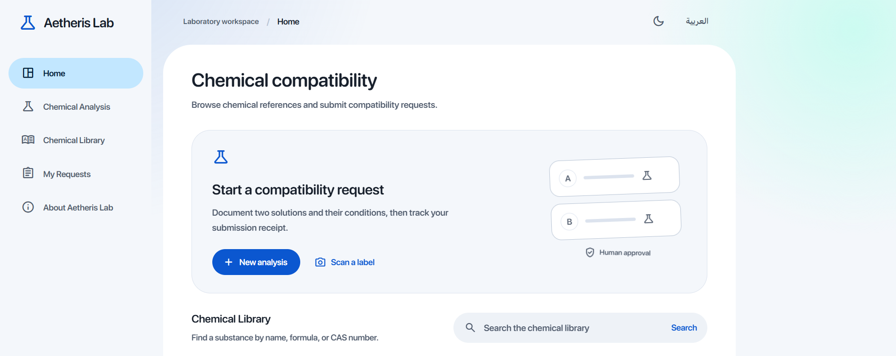
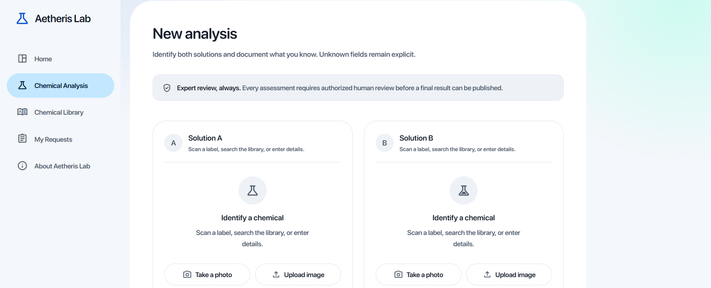
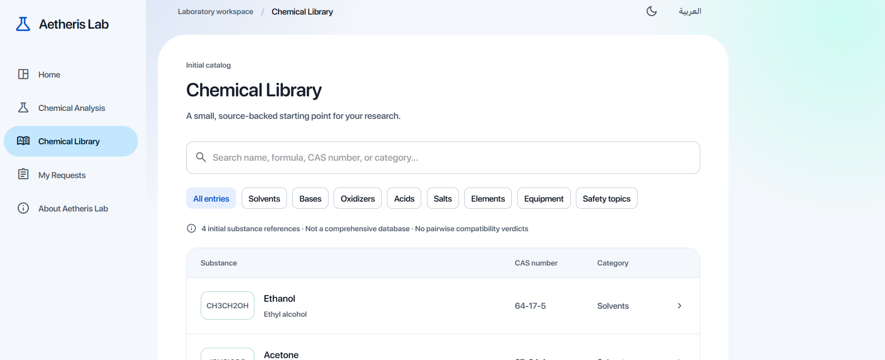
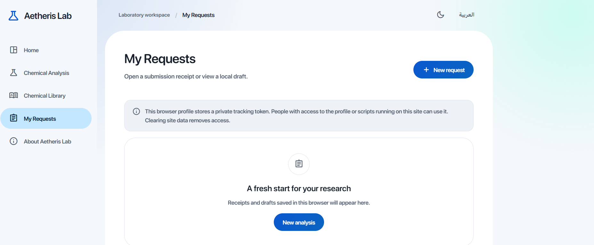
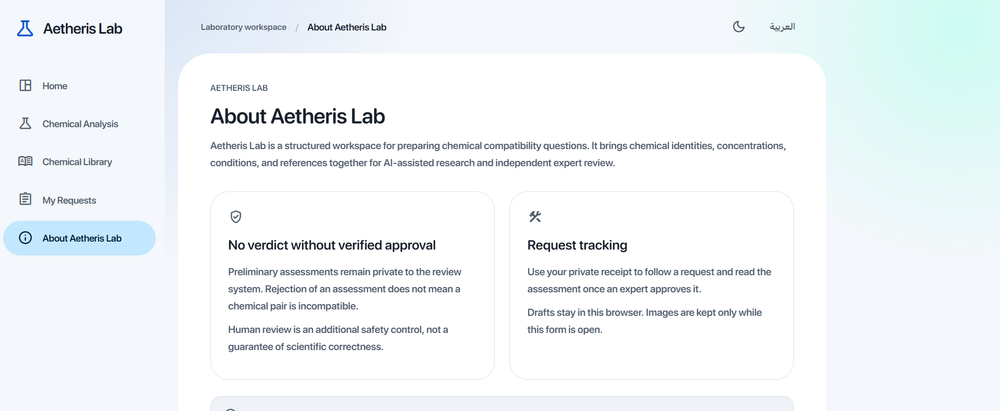

# Aetheris Lab

**Live Deployment:** [https://aetheris-lab-api.shahid-dev-273.workers.dev](https://aetheris-lab-api.shahid-dev-273.workers.dev)

A bilingual React + TypeScript scientific workspace for documenting two solutions and preparing chemical compatibility questions for independent expert review. The public Pages application submits requests and displays token-protected progress and expert-approved assessments, while a separate admin Pages application provides the reviewer workspace. Both call the same Cloudflare Worker backed by D1 and R2

## Screenshots

- **Home:** 
- **Chemical Analysis:** 
- **Chemical Library:** 
- **My Requests:** 
- **About Aetheris Lab:** 

## Run locally

Requirements: Node 22.12+ (Node 26 used for validation) and npm
The Worker tests use Node's built-in SQLite module. On Node 22.12, enable it with `NODE_OPTIONS=--experimental-sqlite` or run the checks with Node 26, as CI does

## License

This project is available for educational and portfolio showcase purposes.
npm ci
npx wrangler d1 migrations apply DB --local
npm run worker:dev
